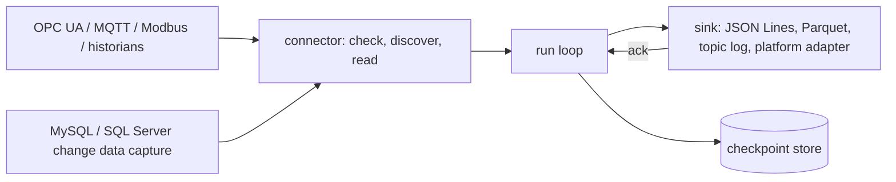

# Hashi (橋)

**A connector engine that bridges plant floors and operational databases into the rest of your stack.**

[](https://github.com/Sannrox/hashi/actions/workflows/ci.yml)
[](https://github.com/Sannrox/hashi/releases)
[](LICENSE)

[Try it](#try-it) · [How it works](#how-it-works) · [Vision](VISION.md) · [Operations](docs/operations.md) · [Decisions](docs/decisions/README.md)

> Status: v0.1 MVP families are in tree. SQL Server CDC and SQL Server
> historian mapping are in tree; Oracle CDC stays on the v0.2 roadmap. See
> [VISION.md](VISION.md).

Hashi (橋, bridge) is a standalone connector engine written in Rust. It reads
industrial sources — OPC UA (browse, subscriptions, historical access), MQTT
3.1.1 and 5 (including Sparkplug B payloads), Modbus TCP and RTU, and process
historians — and operational databases by change data capture — MySQL snapshot
and GTID capture, and SQL Server snapshot with LSN change data capture (change
tracking fallback); Oracle and PostgreSQL follow the same contract on the
roadmap — and delivers typed, keyed records to sinks the rest of the stack
consumes.

- **One connector contract.** Every source family implements check, discover
  and read, with server-owned checkpoints.
- **Apply exactly once.** At-least-once delivery with stable record keys and
  idempotency keys, so a consumer can deduplicate.
- **Resume without gaps.** The run loop commits the checkpoint only after the
  sink acks; a restarted process resumes after the last committed position.
- **Edge and air-gapped.** A single binary, an offline container image that
  runs with no network, and a store-and-forward disk buffer that keeps reading
  while the uplink is down.
- **Secrets stay out of config.** A config names credentials by file path,
  never by value; rewriting the file rotates the credential without a restart.
- **Proven by conformance and soak.** Each family runs a conformance kit
  (snapshot, resume after a kill, duplicate keys, schema drift) and a soak
  harness with fault injection.

Hashi doesn't make governance decisions. It authenticates to sources, reads,
normalizes and delivers. Mapping records to objects, markings and Actions
belongs to the consumer. It runs as a single binary or as one process per
connector, with no runtime network calls besides the configured sources and
sinks.

## Try it

From a fresh clone, run the in-process `fixture` source — the source that
proves the runtime — into a JSON Lines sink. The digest is the SHA-256 of the
credential file's content, so the config never holds the secret
([docs/run.md](docs/run.md)):

```sh
git clone https://github.com/Sannrox/hashi && cd hashi
printf 'quickstart' > secret
cat > quickstart.toml <<'EOF'
checkpoint_dir = "state"

[[instance]]
name = "line-1"
source.fixture = { records = 3, credential_file = "secret", accept_sha256 = ["ed4f0b24c45258342c1851760d29b3f5eafedafde021ae3bad6af8aa7466ae3e"] }
sink.jsonl = { dir = "out/line-1" }
EOF
cargo run -- run --config quickstart.toml --once
```

```text
line-1: delivered 3 quarantined 0 checkpoint 3
```

Every record carries its kind, key, source timestamp, position and an
idempotency key:

```sh
cat out/line-1/kind=*/part.jsonl
```

```text
{"kind":"reading","key":"r1","sourceTsMs":10,"ingestTsMs":1793897969841,"quality":null,"position":1,"payload":"value-1","idempotencyKey":"14:fixture-line-1/6:line-1/7:reading/2:r1/1"}
{"kind":"reading","key":"r2","sourceTsMs":20,"ingestTsMs":1793897969854,"quality":null,"position":2,"payload":"value-2","idempotencyKey":"14:fixture-line-1/6:line-1/7:reading/2:r2/2"}
{"kind":"reading","key":"r3","sourceTsMs":30,"ingestTsMs":1793897969866,"quality":null,"position":3,"payload":"value-3","idempotencyKey":"14:fixture-line-1/6:line-1/7:reading/2:r3/3"}
```

Run it again: the checkpoint has advanced, so nothing is redelivered:

```sh
cargo run -- run --config quickstart.toml --once
```

```text
line-1: delivered 0 quarantined 0 checkpoint 3
```

Protocol sources are configured the same way, one `[[instance]]` per connector
([docs/run.md](docs/run.md)). Without `--once`, `hashi run` keeps passing until
stopped; add `--listen <addr>` for `/healthz` and Prometheus `/metrics`, and
`hashi diagnostics --config <file>` prints a support bundle without secrets,
keys or payloads ([docs/operations.md](docs/operations.md)).

## How it works



A **connector** implements check, discover and read for one source family and
yields **records**: typed, keyed, source-timestamped, with positions that only
grow. The **run loop** delivers each batch to the sink and commits the
**checkpoint** only after the sink acks, so a crash replays at most the
uncommitted tail and the idempotency keys let the consumer drop the replay. A
schema change quarantines records instead of guessing
([docs/schema-drift.md](docs/schema-drift.md)).

The v0 runtime is in-tree: a `Connector` trait, a file-backed checkpoint
store, and a sequential run loop that commits after the sink acks. Sinks: JSON
Lines, partitioned Apache Parquet, a file-backed Kafka-compatible topic log
(idempotent producer, key = record key; no live broker in `cargo test`), and a
versioned platform source-adapter protocol. A store-and-forward disk buffer
keeps reading while the uplink is down. Modbus polling, optional OPC UA secure
discovery/subscriptions, optional MySQL snapshot/GTID capture, and optional
SQL Server capture are implemented. Other source families follow the roadmap.
Tests use fixture sources and isolated simulators.

## Documentation

- [Running from a config file](docs/run.md)
- [Health, metrics, diagnostics and offline packaging](docs/operations.md)
- [Releases](RELEASING.md)
- [Source cursors and change records](docs/source-cursors.md)
- [Schema drift and quarantine](docs/schema-drift.md)
- [Modbus polling](docs/modbus.md)
- [OPC UA sessions, discovery, and subscriptions](docs/opcua.md)
- [MySQL snapshot and change capture](docs/mysql.md)
- [SQL Server snapshot and change capture](docs/mssql.md)
- [MQTT subscriptions](docs/mqtt.md)
- [Historian backfill and live tail](docs/historian.md)
- [Outbox one-shot run mode](docs/outbox.md)
- [Connector conformance kit](docs/conformance.md)
- [Soak harness](docs/soak.md)

## Development

```sh
make validate           # cargo fmt --check, clippy -D warnings, release checks
make test               # cargo test --locked
make test-integration   # optional protocol features and simulator fixtures
```

Default Cargo features are `parquet` and `modbus`. `mqtt`, `mysql`, `mssql`,
`opcua`, and `opcua-simulator` stay off until selected. `cargo check
--no-default-features` builds the runtime without Parquet or serialport. The
crate graph stays one package
([docs/decisions/0001-single-package-crate-graph.md](docs/decisions/0001-single-package-crate-graph.md)).

Contributor and agent policy: [AGENTS.md](AGENTS.md). Decisions:
[docs/decisions/](docs/decisions/README.md). Planning lives in GitHub Issues.

## License

Apache-2.0. The default build admits only permissive dependency licenses;
`cargo deny check licenses` enforces it (`deny.toml`).
